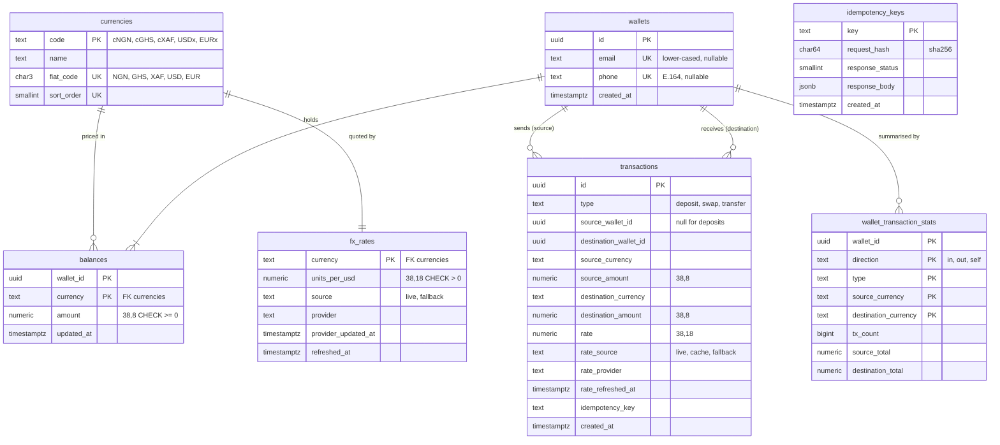

# Pangea FX

**A stablecoin-powered cross-border payment sandbox.** Multi-currency wallets, simulated deposits, FX swaps and wallet-to-wallet transfers across **cNGN, cGHS, cXAF, USDx and EURx**, with live exchange rates and exact money handling.

The name comes from Pangaea, the single supercontinent from before the borders: one ledger, no borders, which is the point of _Operation Borderless_.

- Swagger UI: http://localhost:3000/docs
- OpenAPI spec: [`openapi.json`](openapi.json) (checked against the code by a test)
- Design decisions in depth: [`DECISIONS.md`](DECISIONS.md)

---

## Contents

1. [Quick start](#quick-start)
2. [Tech stack and why](#tech-stack-and-why)
3. [Running the tests](#running-the-tests)
4. [API walkthrough](#api-walkthrough)
5. [Data model](#data-model)
6. [Money precision](#money-precision)
7. [Idempotency](#idempotency)
8. [Concurrency](#concurrency)
9. [FX rates and provider failures](#fx-rates-and-provider-failures)
10. [Assumptions](#assumptions)
11. [Known limitations and what I left out](#known-limitations-and-what-i-left-out)
12. [What I would do with more time](#what-i-would-do-with-more-time)
13. [Configuration](#configuration)
14. [Project layout](#project-layout)

---

## Quick start

Requires Docker.

```bash
docker compose up
```

That builds the API, starts Postgres 16, runs all migrations (including seed fallback FX rates) and fetches live rates. When the API reports healthy:

| What         | Where                                     |
| ------------ | ----------------------------------------- |
| API          | http://localhost:3000/api/v1              |
| Swagger UI   | http://localhost:3000/docs                |
| OpenAPI JSON | http://localhost:3000/docs-json           |
| Health       | http://localhost:3000/health              |
| Postgres     | `localhost:5433` (user/password `pangea`) |

Postgres is published on **5433**, not 5432, so it does not clash with a locally installed Postgres. Override with `DB_PORT=5432 docker compose up`.

The first build downloads all dependencies once (a few minutes on a slow connection); later builds reuse a cache and take about 30 seconds.

Migrations run automatically on startup. They can also be run by hand: `yarn build && yarn migrate` (and `yarn migrate:rollback`), using `DATABASE_URL` from `.env`.

### Local development without the API container

```bash
docker compose up -d db
cp .env.example .env
yarn install
yarn start:dev        # tsc --watch + node --watch on http://localhost:3000
```

---

## Tech stack and why

| Area          | Choice                                                                                             | Why                                                                                                                                                                                             |
| ------------- | -------------------------------------------------------------------------------------------------- | ----------------------------------------------------------------------------------------------------------------------------------------------------------------------------------------------- |
| Runtime       | **Node.js 24 LTS** (22.22+ also works), **TypeScript 6**, `strict` plus `noUncheckedIndexedAccess` | Required by the brief; the extra checks catch undefined array and map access at compile time.                                                                                                   |
| Framework     | **NestJS 12**                                                                                      | Modules, dependency injection and interceptors fit the cross-cutting parts (idempotency, validation). Swagger is generated from the same DTOs that validate requests, so the docs cannot drift. |
| Database      | **PostgreSQL 16**                                                                                  | See below.                                                                                                                                                                                      |
| Data access   | **Knex**                                                                                           | Transactions, `SELECT … FOR UPDATE` and lock ordering stay explicit and readable. ORMs tend to hide exactly the parts a ledger needs to show.                                                   |
| Money         | **decimal.js** in code, `NUMERIC` in the database                                                  | No JavaScript float ever touches an amount.                                                                                                                                                     |
| Validation    | class-validator DTOs, global `ValidationPipe`                                                      | Unknown fields are rejected; one clear message per field.                                                                                                                                       |
| Scheduling    | `@nestjs/schedule` (in-process cron)                                                               | Daily FX refresh and hourly idempotency-key cleanup.                                                                                                                                            |
| Cache / queue | **None**                                                                                           | Nothing here earns one; see [Why there is no Redis](#why-there-is-no-redis-or-any-cache-or-queue).                                                                                              |
| Tests         | **Vitest + Supertest**, real Postgres via **Testcontainers**                                       | The bugs that matter in a ledger (races, locks, rounding, constraint violations) only show up against a real database.                                                                          |
| Tooling       | Yarn 1, ESLint (type-aware), Prettier, Husky pre-commit                                            | The pre-commit hook runs lint-staged, the type checker and the unit tests.                                                                                                                      |

### Why PostgreSQL over MongoDB

A wallet ledger is relational and transactional by nature, and Postgres gives every guarantee it needs natively:

- **ACID transactions across rows**: a transfer debits one balance, credits another and records the transaction atomically.
- **Row locks** (`SELECT … FOR UPDATE`) to serialise competing debits on the same balance.
- **Exact decimals** (`NUMERIC(38,8)`), so the database never rounds money.
- **Constraints as a last line of defence**: `CHECK (amount >= 0)` on balances, `UNIQUE` email and phone, foreign keys to the currency table, and a `CHECK` that enforces the shape of each transaction type. Even a bug in application code cannot write a negative balance or an impossible transaction.

MongoDB can do multi-document transactions, but has no `CHECK` constraints, no foreign keys and no native exact decimal arithmetic in queries, so each of those guarantees would have to be rebuilt in application code.

### Why there is no Redis (or any cache or queue)

The brief allows Redis, BullMQ or RabbitMQ "only where it earns its place". Nothing in this API needs one yet, so I left them out on purpose. Every job Redis would normally do here is already done by Postgres, and in a money system Postgres does it more safely:

| Usual job for Redis                  | What Pangea FX does instead                                                                    | Why that is enough, or better                                                                                                                                                                                                  |
| ------------------------------------ | ---------------------------------------------------------------------------------------------- | ------------------------------------------------------------------------------------------------------------------------------------------------------------------------------------------------------------------------------ |
| Idempotency key store                | `idempotency_keys` table, committed in the **same database transaction** as the money movement | With Redis, the key and the payment live in two systems. A crash between writing one and the other can process a payment twice or block a safe retry. One Postgres transaction makes that impossible. This is the main reason. |
| Distributed lock for balance updates | `SELECT … FOR UPDATE` on the balance rows, in a fixed order                                    | The lock is on the balance itself and is released on commit or crash. A Redis lock can expire mid-payment, or outlive a process that died holding it.                                                                          |
| FX rate cache                        | `fx_rates` table with a 1-hour TTL and a daily refresh                                         | The provider publishes once a day, and reading 5 rows takes under a millisecond. A cache in front of that saves nothing, and every API instance already sees the same rates.                                                   |
| Counters and analytics               | `wallet_transaction_stats`, kept by a trigger in the same transaction as each movement         | Totals must agree exactly with the ledger, and `yarn reconcile` proves they do. Counters in Redis drift whenever one write succeeds and the other fails.                                                                       |
| Job queue (BullMQ, RabbitMQ)         | In-process cron for the daily FX refresh and hourly key cleanup                                | Two small jobs, both safe to run twice. A queue would be more infrastructure for no gain.                                                                                                                                      |

Adding Redis would have meant a second source of truth for money-related state, a second service that can be down, and more setup for anyone running the project, all for speed the benchmark shows is not needed: history requests take 11 to 28 ms on a wallet with 100,000 transactions.

**When it would earn its place:**

- **Rate limiting** per client or wallet across several API instances: fast shared counters where occasional drift does not matter. This is the first place I would add it.
- **Several API instances**, where the cron jobs need a leader lock so only one instance runs them.
- **Notifications** such as "transfer received": the event would be written to Postgres first (an outbox table committed with the payment) and only then published through Redis or a queue.
- **Very hot public reads**, such as a heavily used rates endpoint, where serving slightly stale data is acceptable.

---

## Running the tests

Requires Node 22.22+ (or 24), Yarn 1.x and Docker running.

```bash
yarn install
yarn test          # full suite: unit + e2e (~25 s)
yarn test:unit     # unit tests only, no Docker needed (~1 s)
yarn test:e2e      # e2e only
yarn test:cov      # with coverage (about 90% of lines)
```

The e2e suite starts a throwaway Postgres 16 container with Testcontainers, runs every migration, and tests the API over HTTP. To use your own database instead, set `TEST_DATABASE_URL` to an **empty** Postgres 16 database. If neither Docker nor `TEST_DATABASE_URL` is available, the suite stops with a message saying so.

**323 tests** cover, among others:

- **Concurrency**: 10 concurrent swaps or transfers of 15 against a balance of 100 (exactly 6 succeed); 30 opposite-direction transfers across currencies (no deadlock, value conserved); 10 concurrent wallet creations with the same email (exactly one 201).
- **Idempotency**: replays, 10 concurrent identical requests (exactly one transaction), key reuse with a different body (422), a 400 not consuming the key, a 5xx releasing it, a duplicate waiting for the in-flight original, a 409 after the wait times out, key expiry.
- **Money**: rounding down, 30-digit balances, no float drift (`0.1 + 0.2 = 0.30000000`), overflow rejected.
- **FX**: live → cache → fallback with a controllable clock, provider backoff, single-flight refresh, malformed provider responses, the daily cron.
- **A randomised ledger burst**: 300 random concurrent deposits, swaps, transfers, overspends and replays across 6 wallets, after which every balance must equal the sum of its transactions, no balance may be negative, and rounding must never have created value. It is seeded; a failure prints `LEDGER_SEED=…` to reproduce it.
- **Migrations**: up, down and up again on a fresh database, and upgrades over existing data.
- **Docs**: the committed `openapi.json` must match what the code generates.

### Checking a live database

```bash
yarn build && yarn reconcile
```

Recomputes every balance and every history summary from the transaction log and exits 1, listing each mismatch, if anything disagrees.

---

## API walkthrough

**Try it yourself:** [`http/`](http/) has runnable sample requests for every endpoint and error case (VS Code REST Client or JetBrains HTTP Client). Each file creates its own wallets and chains the ids, so you can click through it top to bottom. Swagger UI at http://localhost:3000/docs works too.

All examples below are **real responses** captured from the running stack (`docker compose up`) with live rates. Long ids are shortened for readability. Every `POST` that moves money needs an `Idempotency-Key` header.

| Method | Path                                        | Purpose                                                                 |
| ------ | ------------------------------------------- | ----------------------------------------------------------------------- |
| POST   | `/api/v1/wallets`                           | Create a wallet (email and/or phone)                                    |
| GET    | `/api/v1/wallets/lookup?email=` / `?phone=` | Find a wallet by contact                                                |
| GET    | `/api/v1/wallets/:id`                       | Wallet with balances                                                    |
| GET    | `/api/v1/wallets/:id/balances`              | Balances with USD value per line and in total                           |
| POST   | `/api/v1/wallets/:walletId/deposits`        | Simulated deposit                                                       |
| POST   | `/api/v1/wallets/:walletId/swaps`           | Swap between stablecoins in one wallet                                  |
| POST   | `/api/v1/wallets/:walletId/transfers`       | Send to another wallet, same or other currency                          |
| GET    | `/api/v1/wallets/:walletId/transactions`    | History: newest first, filters, cursor pagination, totals and analytics |
| GET    | `/api/v1/transactions/:id`                  | One transaction                                                         |
| GET    | `/api/v1/rates`                             | All 20 pair rates with source and refresh time                          |
| GET    | `/api/v1/currencies`                        | Supported stablecoins                                                   |
| GET    | `/health`                                   | API and database health                                                 |

### 1. Create a wallet

```bash
curl -X POST localhost:3000/api/v1/wallets \
  -H 'content-type: application/json' \
  -d '{"email":"ada@example.com"}'
```

```json
{
  "id": "b03ff100-ba1f-4865-ae4c-f8fe14e58f8e",
  "email": "ada@example.com",
  "phone": null,
  "createdAt": "2026-10-29T14:20:39.133Z",
  "balances": [
    { "currency": "cNGN", "amount": "0.00000000" },
    { "currency": "cGHS", "amount": "0.00000000" },
    { "currency": "cXAF", "amount": "0.00000000" },
    { "currency": "USDx", "amount": "0.00000000" },
    { "currency": "EURx", "amount": "0.00000000" }
  ]
}
```

A wallet can be created with `email`, `phone` (international format, separators ignored, e.g. `"+233 20 123 4567"`) or both. Emails are case-insensitive, so the same address in capitals is a duplicate:

```json
// POST /api/v1/wallets {"email":"ADA@example.com"}  → 409
{ "message": "A wallet already exists for this email", "error": "Conflict", "statusCode": 409 }
```

### 2. Deposit

```bash
curl -X POST localhost:3000/api/v1/wallets/$ADA/deposits \
  -H 'content-type: application/json' -H 'Idempotency-Key: dep-1' \
  -d '{"currency":"USDx","amount":"500"}'
```

```json
{
  "id": "0c68b23f-f795-47c2-a554-8830c4b4014f",
  "type": "deposit",
  "sourceWalletId": null,
  "destinationWalletId": "b03ff100-…",
  "sourceCurrency": "USDx",
  "sourceAmount": "500.00000000",
  "destinationCurrency": "USDx",
  "destinationAmount": "500.00000000",
  "rate": "1",
  "rateSource": null,
  "rateProvider": null,
  "rateRefreshedAt": null,
  "idempotencyKey": "dep-1",
  "createdAt": "2026-10-29T14:20:42.727Z"
}
```

Sending the exact same request again returns the same body without depositing twice:

```http
HTTP/1.1 201 Created
Idempotent-Replayed: true
```

### 3. Swap

```bash
curl -X POST localhost:3000/api/v1/wallets/$ADA/swaps \
  -H 'content-type: application/json' -H 'Idempotency-Key: swap-1' \
  -d '{"fromCurrency":"USDx","toCurrency":"cNGN","amount":"100"}'
```

```json
{
  "id": "4d6247c0-883b-4629-a322-cb8513b3e405",
  "type": "swap",
  "sourceWalletId": "b03ff100-…",
  "destinationWalletId": "b03ff100-…",
  "sourceCurrency": "USDx",
  "sourceAmount": "100.00000000",
  "destinationCurrency": "cNGN",
  "destinationAmount": "134623.68880000",
  "rate": "1346.236888",
  "rateSource": "live",
  "rateProvider": "open.er-api.com",
  "rateRefreshedAt": "2026-10-29T14:20:37.387Z",
  "idempotencyKey": "swap-1",
  "createdAt": "2026-10-29T14:20:43.671Z"
}
```

A swap that would make a balance negative is rejected and changes nothing:

```json
// {"fromCurrency":"USDx","toCurrency":"EURx","amount":"1000"}  → 422
{
  "message": "Insufficient USDx balance: available 400.00000000, requested 1000.00000000",
  "error": "Unprocessable Entity",
  "statusCode": 422
}
```

### 4. Transfer across currencies

`toCurrency` is optional and defaults to `fromCurrency`.

```bash
curl -X POST localhost:3000/api/v1/wallets/$ADA/transfers \
  -H 'content-type: application/json' -H 'Idempotency-Key: tr-1' \
  -d '{"toWalletId":"'$KOFI'","fromCurrency":"cNGN","toCurrency":"cGHS","amount":"50000"}'
```

```json
{
  "id": "fd990403-4c80-4231-b127-c4e419fd79df",
  "type": "transfer",
  "sourceWalletId": "b03ff100-…",
  "destinationWalletId": "14f0e0bc-…",
  "sourceCurrency": "cNGN",
  "sourceAmount": "50000.00000000",
  "destinationCurrency": "cGHS",
  "destinationAmount": "432.31306851",
  "rate": "0.00864626137030944",
  "rateSource": "live",
  "rateProvider": "open.er-api.com",
  "rateRefreshedAt": "2026-10-29T14:20:37.387Z",
  "idempotencyKey": "tr-1",
  "createdAt": "2026-10-29T14:20:43.921Z"
}
```

The cGHS/cNGN rate is derived from two USD quotes (`11.639916 / 1346.236888`), and `50000 × rate` is rounded **down** to 8 dp.

### 5. Balances with USD total

```bash
curl localhost:3000/api/v1/wallets/$ADA/balances
```

```json
{
  "walletId": "b03ff100-…",
  "balances": [
    { "currency": "cNGN", "amount": "84623.68880000", "usdValue": "62.85943399" },
    { "currency": "cGHS", "amount": "0.00000000", "usdValue": "0.00000000" },
    { "currency": "cXAF", "amount": "0.00000000", "usdValue": "0.00000000" },
    { "currency": "USDx", "amount": "400.00000000", "usdValue": "400.00000000" },
    { "currency": "EURx", "amount": "0.00000000", "usdValue": "0.00000000" }
  ],
  "totalUsd": "462.85943399",
  "valuation": {
    "source": "live",
    "ratesAsOf": "2026-10-29T14:20:37.387Z",
    "provider": "open.er-api.com"
  }
}
```

`totalUsd` is the sum of the rounded lines, so the response always adds up.

### 6. Transaction history

```bash
curl 'localhost:3000/api/v1/wallets/'$ADA'/transactions?limit=2'
```

```json
{
  "data": [
    {
      "id": "fd990403-…",
      "type": "transfer",
      "direction": "out",
      "sourceCurrency": "cNGN",
      "sourceAmount": "50000.00000000",
      "destinationCurrency": "cGHS",
      "destinationAmount": "432.31306851",
      "rate": "0.00864626137030944",
      "createdAt": "2026-10-29T14:20:43.921Z"
    },
    {
      "id": "4d6247c0-…",
      "type": "swap",
      "direction": "self",
      "sourceCurrency": "USDx",
      "sourceAmount": "100.00000000",
      "destinationCurrency": "cNGN",
      "destinationAmount": "134623.68880000",
      "rate": "1346.236888",
      "createdAt": "2026-10-29T14:20:43.671Z"
    }
  ],
  "nextCursor": "eyJ0IjoiMjAyNi0xMC0yOSAxNDoyMDo0My42NzEzOTIrMDAiLCJpIjoiNGQ2MjQ3YzAtODgzYi00NjI5LWEzMjItY2I4NTEzYjNlNDA1In0",
  "pagination": { "limit": 2, "totalCount": 4, "totalPages": 2, "hasMore": true },
  "summary": {
    "transactionCount": 4,
    "countByType": { "deposit": 1, "swap": 1, "transfer": 2 },
    "debits": [
      { "currency": "USDx", "amount": "150.00000000", "usdValue": "150.00000000" },
      "… one entry per currency, zero where nothing moved"
    ],
    "credits": [
      { "currency": "cNGN", "amount": "134623.68880000", "usdValue": "99.99999999" },
      { "currency": "cGHS", "amount": "20.00000000", "usdValue": "1.71822545" },
      { "currency": "USDx", "amount": "500.00000000", "usdValue": "500.00000000" },
      "…"
    ],
    "totalDebitUsd": "150.00000000",
    "totalCreditUsd": "601.71822544",
    "netUsd": "451.71822544",
    "valuation": {
      "source": "live",
      "ratesAsOf": "2026-10-29T16:35:38.762Z",
      "provider": "open.er-api.com"
    }
  }
}
```

(Each item also carries every other transaction field, and `debits`/`credits` list all five currencies; trimmed here.)

- Newest first. `direction` is relative to this wallet: `in` (deposit or transfer received), `out` (transfer sent) or `self` (swap).
- Filters: `type=deposit|swap|transfer` and `currency=cNGN|…` (either side of the movement). They combine, and apply to the summary too.
- Pagination: `limit` (1–1000, **default 10**) and `cursor=<nextCursor>`. `pagination` gives `totalCount`, `totalPages` and `hasMore`; `nextCursor` is `null` on the last page.
- `summary` covers **every transaction matching the filters across all pages**, so it is the same on every page: counts per type, totals debited and credited per currency with their USD value, and overall `totalDebitUsd`, `totalCreditUsd` and `netUsd`. USD values use current rates, named in `valuation`.
- The cNGN line above is worth `99.99999999`, not `100`: the swap rounded down converting 100 USDx into cNGN, and the valuation rounds down again converting back. Rounding never creates value.
- The receiving wallet sees the same transfer with `"direction": "in"`.

`GET /api/v1/transactions/:id` returns a single transaction in the same shape, without `direction`.

#### History performance

The summary is not computed by scanning history. A Postgres trigger keeps running totals in `wallet_transaction_stats` (one row per wallet, direction, type and currency pair, so at most about 75 rows per wallet), updated in the same database transaction as each movement. Every filter maps onto those rows, so a summary reads a handful of rows however long the history is. The page itself is two LIMITed index scans merged by Postgres.

Measured on a wallet with **100,000 transactions** (Docker, warm, median of 5 requests):

| Request                                       | Time                          |
| --------------------------------------------- | ----------------------------- |
| First page (default 10) with full summary     | 17 ms                         |
| First page, `limit=1000`                      | 28 ms                         |
| A page ~90,000 rows deep, via cursor          | 11 ms                         |
| Filtered by currency                          | 11 ms                         |
| Database: summary read (stats rows)           | 0.2 ms                        |
| Database: the naive `COUNT`/`SUM` it replaces | 55 ms, and grows with history |

The stats table is updated on every movement, so it is tuned for that: `fillfactor = 50` lets updates happen in place (HOT: 94% of updates in the test), and autovacuum runs after a fixed number of dead rows. After 2,000 more concurrent deposits to the same wallet the read was still 0.25 ms with no dead rows. `yarn reconcile` and the randomised burst test check the stats against the transaction log.

### 7. Rates

```bash
curl 'localhost:3000/api/v1/rates?from=USDx'
```

```json
{
  "provider": {
    "name": "open.er-api.com",
    "url": "https://www.exchangerate-api.com",
    "updateFrequency": "daily",
    "attribution": "Rates By Exchange Rate API"
  },
  "rates": [
    {
      "from": "USDx",
      "to": "cNGN",
      "rate": "1346.236888",
      "source": "live",
      "provider": "open.er-api.com",
      "providerUpdatedAt": "2026-10-29T00:02:31.000Z",
      "refreshedAt": "2026-10-29T14:20:37.387Z"
    },
    { "from": "USDx", "to": "cGHS", "rate": "11.639916", "…": "…" },
    { "from": "USDx", "to": "cXAF", "rate": "588.52908", "…": "…" },
    { "from": "USDx", "to": "EURx", "rate": "0.897215", "…": "…" }
  ]
}
```

Without filters it returns all 20 ordered pairs. `from` and `to` together return one pair. `refreshedAt` is when we last stored the rate; `providerUpdatedAt` is when the provider published it.

### Errors

Errors use Nest's standard shape. Validation errors list one message per invalid field:

```json
{
  "message": [
    "amount must be a positive decimal string with at most 8 decimal places, e.g. \"100.50\""
  ],
  "error": "Bad Request",
  "statusCode": 400
}
```

| Status | Meaning                                                                                                    |
| ------ | ---------------------------------------------------------------------------------------------------------- |
| 400    | Invalid input, missing or malformed `Idempotency-Key`, invalid cursor, self-transfer                       |
| 404    | Wallet or transaction not found                                                                            |
| 409    | Duplicate wallet contact, or the same `Idempotency-Key` is still being processed                           |
| 422    | Insufficient funds, amount too small to convert, balance overflow, or a key reused for a different request |

---

## Data model



Design points:

- **`transactions` is the source of truth; `balances` is a cache of it.** Every balance equals the sum of its transactions. `yarn reconcile` and the burst test verify this exactly.
- **One row per movement.** A transfer is a single row seen by both wallets, recording sender, receiver, both amounts and currencies, the rate applied, its source and provider, and a timestamp.
- **Each wallet gets one balance row per currency at creation**, so every money operation locks an existing row instead of racing to insert one.
- **A `CHECK` constraint defines what each type may look like**: a deposit has no source wallet and rate 1, a swap stays in one wallet and changes currency, a transfer moves between two different wallets.
- **Rates are stored as one quote per currency against USD** (5 rows, not 20 pairs). Every pair is derived from two quotes, so cross rates can never contradict each other.
- **History reads** use `(wallet, created_at desc, id desc)` indexes on both sides of a transaction.
- **History summaries** come from `wallet_transaction_stats`, running totals kept by a trigger on `transactions` in the same database transaction, so they cost a few rows regardless of history length and can never drift from the log.
- **Eight migrations**, applied in order and never edited once applied. Each later change (moving currencies into a table, recording the rate provider, letting idempotency keys expire, adding history summaries) is its own migration, tested for upgrade over existing data and for rollback.

---

## Money precision

- **Storage**: amounts are `NUMERIC(38,8)` (up to 30 integer digits, 8 decimals); rates are `NUMERIC(38,18)`.
- **Code**: all arithmetic uses `decimal.js` at 50 significant digits. No JavaScript `number` ever holds an amount.
- **API**: amounts go in and out as decimal strings (`"1500.25"`). JSON numbers are rejected on input, because they have already been parsed as floats by the time the server sees them. Input must be positive and have at most 8 decimal places.
- **Rates** are rounded once to 15 significant digits, and the rounded rate is what gets applied and stored, so every transaction can be re-derived exactly from its amount and rate.
- **Conversions round down** to 8 dp. The platform never credits more than the exact conversion, so rounding can only ever lose a fraction of the smallest unit, never create value. The burst test asserts this across hundreds of random conversions.
- **Overflow**: a credit that would exceed `NUMERIC(38,8)` is rejected with a 422 and changes nothing.

---

## Idempotency

Deposits, swaps and transfers require an `Idempotency-Key` header. The implementation is an interceptor around those routes ([`idempotency.interceptor.ts`](src/idempotency/idempotency.interceptor.ts)):

- **The key and the money movement commit in one database transaction.** The first request inserts the key (its primary key acts as the lock), runs the handler in a savepoint, stores the response, and commits it all together. A crash rolls everything back, key included, so there is no "processing" state that can get stuck.
- **A duplicate while the original is in flight** blocks on that insert until the original commits, then replays its response. If it waits longer than `IDEMPOTENCY_LOCK_TIMEOUT_MS` (5 s) it gets a **409**.
- **A completed key** replays the stored status and body with `Idempotent-Replayed: true`. The handler does not run again.
- **The same key with a different request** (method, path or body, hashed as canonical JSON so key order does not matter) gets a **422**.
- **A 400 is not stored**, because nothing ran, so the corrected request can reuse the key. Other 4xx responses (404, 422) are stored and replayed. A 5xx releases the key.
- **Keys are kept for 24 hours**, then deleted by an hourly job, like Stripe's window. Each transaction keeps its key for audit.

---

## Concurrency

- **One database transaction per operation.**
- **Debits lock before they check.** A swap or transfer locks both balance rows with one `SELECT … FOR UPDATE` ordered by `(wallet_id, currency)`, checks funds against the locked amount, then writes. Because every operation locks in the same order, two transfers in opposite directions cannot deadlock.
- **Credits** (deposits) are a single atomic `UPDATE … SET amount = amount + x`, so concurrent deposits cannot lose updates.
- **Uniqueness races** (two identical wallet creations) are settled by the database's `UNIQUE` constraints, returning one 201 and the rest 409.
- **`CHECK (amount >= 0)`** means even a logic bug cannot leave a negative balance.
- **No request ever needs a second database connection.** Every query in a request runs on that request's connection (via `AsyncLocalStorage`). Without this rule, 10 concurrent swaps against a pool of 10 hung forever; the test suite now catches that.

---

## FX rates and provider failures

- **Provider**: [open.er-api.com](https://www.exchangerate-api.com), free and keyless, and it covers NGN, GHS and XAF. Rates By Exchange Rate API. It publishes once a day, so "live" means its latest daily rate; every rate shows `providerUpdatedAt`.
- **Refresh**: a daily cron just after the provider publishes (00:10 UTC), a background refresh at startup, and a lazy refresh on read when stored rates are older than the TTL (1 hour). Concurrent refreshes share one provider call.
- **Fallback chain**: fresh live rate → last stored live rate (`cache`) → fixed seed rate from the migration (`fallback`). The seed rates are indicative, and cXAF is derived from the fixed EUR peg of 655.957 XAF per EUR.
- **When the provider fails** (timeout after 3 s, error status, malformed or partial response), nothing is stored, the stored rates are served with their honest `source`, and the provider is not called again for 60 s, so an outage costs one timeout rather than one per request.
- **Money operations never call the provider.** Swaps and transfers use the stored quotes, so a slow or failing provider can never hold balance locks or delay a payment. The rate's source, provider and refresh time are recorded on each transaction.
- **Visibility**: every rate, balance valuation and transaction says where its rate came from (`live`, `cache` or `fallback`).

---

## Assumptions

- **No authentication**, as the brief says. Anyone who knows a wallet id can act on it. Ids are random UUIDs, and `GET /wallets/lookup` finds a wallet by its email or phone.
- **Deposits are simulated**: no payment rail; the balance is credited immediately.
- **Stablecoins track their fiat 1:1**, so cNGN is priced as NGN, and so on.
- **One rate for both directions**: no spread or fees. A real platform would quote buy and sell rates and charge a fee.
- **Amounts in a swap or transfer are in the source currency**: you say how much leaves your wallet; the receiver gets that times the rate, rounded down.
- **A transfer to yourself is not allowed**; a swap is the way to change currency within one wallet.
- **Phone numbers must be international** (E.164, e.g. `+2348031234567`); local formats like `0803…` are rejected rather than guessed.

---

## Known limitations and what I left out

- **No authentication or authorisation.** Out of scope per the brief.
- **Idempotency keys are global**, not scoped per client, because there are no clients without authentication. With auth, keys would be scoped per account.
- **History pagination edge case**: `created_at` is a transaction's start time. A transaction that starts before, but commits after, a row a client has already paged past can be missed by that client mid-pagination. A commit-ordered sequence column would close this.
- **open.er-api.com updates once a day**, so "live" rates can be up to about 24 hours old, and say so via `providerUpdatedAt`. A paid provider would give intraday rates.
- **Error responses use Nest's default shape.** I did not add a custom error envelope (error codes, request ids) because it would touch every endpoint late in the build for little reviewer value.
- **No rate limiting, request logging with correlation ids, or metrics.**
- **No quotes or slippage protection**: a swap executes at the stored rate at the time of the request. A real platform would issue a time-limited quote and let the client accept it.
- **Cron jobs run in every API process.** With several instances, each would run the daily refresh and the key cleanup. Both are safe to run concurrently (an upsert and a delete), just redundant.

---

## What I would do with more time

1. **Authentication** (API keys or OAuth), wallets owned by accounts, and idempotency keys scoped per account.
2. **Quotes**: `POST /quotes` returning a rate locked for 30 seconds, then `POST /swaps {quoteId}`, with spreads and fees.
3. **Double-entry ledger**: postings per account (including platform accounts for FX and fees) instead of one row per movement, so fees and FX P&L are first-class.
4. **A commit-ordered sequence** for history pagination and event streaming.
5. **Outbox and webhooks** for "transfer received" notifications.
6. **Observability**: structured logs with request ids, Prometheus metrics (FX source mix, idempotent replays, lock wait times), and `yarn reconcile` as a scheduled job with alerting.
7. **A second FX provider** behind the same interface, compared against the first to detect bad data before it is used.
8. **Rate limiting** per client and per wallet.

---

## Configuration

All settings are environment variables, validated at startup: an invalid value stops the app with a clear message. Docker Compose sets sensible defaults; see [`.env.example`](.env.example).

| Variable                      | Default                                 | Purpose                                                  |
| ----------------------------- | --------------------------------------- | -------------------------------------------------------- |
| `PORT`                        | `3000`                                  | HTTP port                                                |
| `DATABASE_URL`                | (required)                              | Postgres connection string                               |
| `DB_MIGRATE_ON_BOOT`          | `true`                                  | Run pending migrations at startup                        |
| `FX_PROVIDER_URL`             | `https://open.er-api.com/v6/latest/USD` | USD-based rates endpoint                                 |
| `FX_CACHE_TTL_SECONDS`        | `3600`                                  | Serve stored live rates this long without refreshing     |
| `FX_TIMEOUT_MS`               | `3000`                                  | Provider request timeout                                 |
| `FX_RETRY_BACKOFF_SECONDS`    | `60`                                    | Wait after a failed refresh before calling again         |
| `FX_REFRESH_CRON`             | `10 0 * * *`                            | Scheduled refresh (UTC), or `off`                        |
| `FX_REFRESH_ON_BOOT`          | `true`                                  | Refresh in the background at startup                     |
| `IDEMPOTENCY_KEY_TTL_HOURS`   | `24`                                    | How long keys are honoured                               |
| `IDEMPOTENCY_CLEANUP_CRON`    | `15 * * * *`                            | When expired keys are deleted (UTC), or `off`            |
| `IDEMPOTENCY_LOCK_TIMEOUT_MS` | `5000`                                  | How long a duplicate waits for the original before a 409 |
| `DB_PORT`                     | `5433`                                  | Compose only: host port for Postgres                     |

---

## Project layout

```
src/
  wallets/        wallet creation, lookup, balances with USD valuation
  deposits/       simulated deposits
  swaps/          swap controller
  transfers/      transfer controller
  ledger/         LedgerService.move (shared by swaps and transfers), reconciliation
  transactions/   history, cursor pagination, lookup by id
  fx/             provider, rate cache, fallback chain, daily refresh
  currencies/     supported stablecoins (the database is the source of truth)
  idempotency/    Idempotency-Key interceptor and key expiry
  database/       Knex, TransactionManager (AsyncLocalStorage), migrations
  common/         money maths (decimal.js), validators
test/             e2e suites (real Postgres via Testcontainers) and helpers
http/             runnable sample requests for every endpoint (REST Client)
openapi.json      generated spec, checked against the code by a test
DECISIONS.md      design decisions and the brief coverage table
```

Useful scripts: `yarn build`, `yarn start`, `yarn start:dev`, `yarn test`, `yarn lint`, `yarn format`, `yarn migrate`, `yarn migrate:rollback`, `yarn reconcile`, `yarn openapi:export`.
